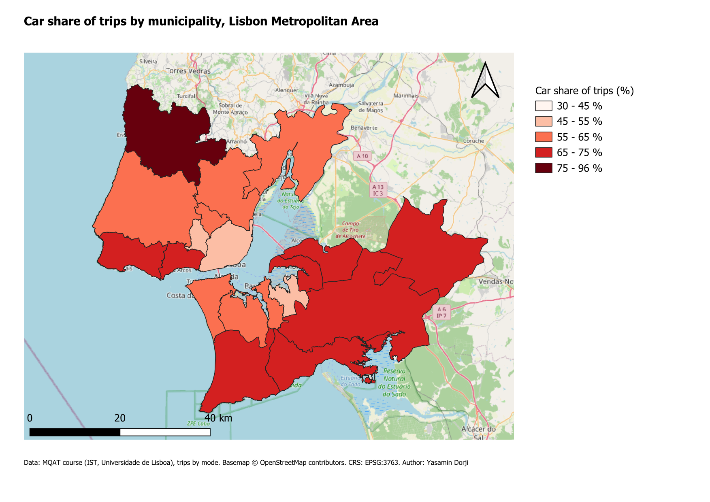
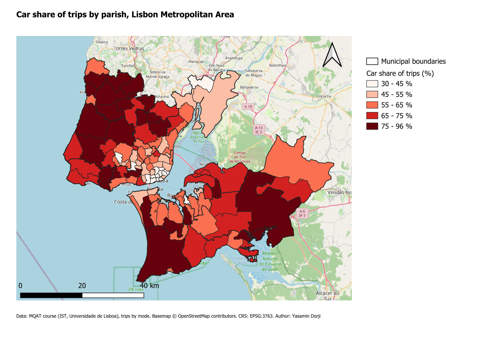
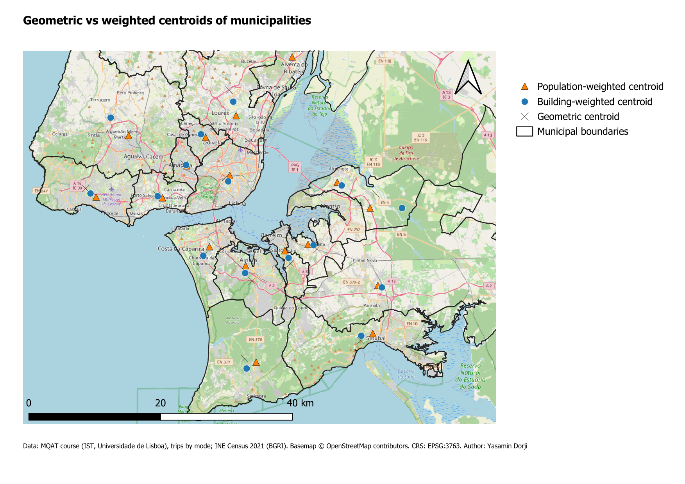

# Transport Zones Analysis: Lisbon Metropolitan Area (QGIS)

  

Car mode share by transport zone in the Lisbon Metropolitan Area (AML), mapped at two spatial scales, plus geometric and weighted zone centroids for origin–destination analysis.

This is a practice exercise from the course *Methods of Quantitative Analysis in Transport (MQAT)*, MSc Transportation Systems, Instituto Superior Técnico (Lisbon). It uses course-provided data; the maps, workflow and observations are my own.

## Objective
- Map the car share of trips by municipality (18 zones) and by parish (118 zones).
- Build zone centroids (geometric, and weighted by population or by buildings) as a basis for desire-line analysis.

## Data
Raw data is not redistributed. Trip data come from the IMOB 2018 mobility survey (INE), as prepared in the MQAT course repository; zone boundaries are based on CAOP 2022. Population and building counts come from the Census 2021 BGRI (INE). See [`data/README.md`](data/README.md).

## Methods
1. Loaded the municipality and parish trip layers in QGIS 3.44. The source layers are in EPSG:4326; the project CRS was set to **EPSG:3763** (ETRS89 / Portugal TM06), so that distances and areas are in metres.
2. Car share (%) computed with a field expression: `"Car" / "Total" * 100`.
3. Graduated symbology with **the same manual classes on both maps** (30–45, 45–55, 55–65, 65–75, 75–96 %), so the two zoning levels can be compared directly.
4. **Geometric centroids** of the municipalities (*Vector → Geometry Tools → Centroids*).
5. **Weighted centroids** from Census 2021 BGRI blocks (*Vector → Analysis Tools → Mean Coordinate(s)*), grouped by municipality code (`DTMN21`) and weighted by resident population (`N_INDIVIDUOS`) or by number of buildings (`N_EDIFICIOS_CLASSICOS`).
6. Maps composed in the QGIS Print Layout (legend, scale bar, north arrow, data sources).
7. Figures checked and centroid distances measured with a short R script ([`scripts/centroid_distances.R`](scripts/centroid_distances.R), package `sf`).

## Results

### Car share of trips by municipality


### Car share of trips by parish


### Geometric vs weighted centroids (detail view)


*Detail view of the central AML; Mafra and part of Vila Franca de Xira are outside the frame.*

## Observations

**Scale changes the picture (MAUP).** Car share ranges from 48% (Lisboa) to 77% (Mafra) across the 18 municipalities, but from 30% to 96% across the 118 parishes. Aggregating to municipalities hides large internal differences:

| Municipality | Municipal car share | Parish range within it |
|---|---|---|
| Lisboa (24 parishes) | 48.0 % | 30.2 – 68.2 % |
| Loures (10) | 62.4 % | 50.9 – 94.6 % |
| Mafra (11) | 77.4 % | 55.1 – 95.8 % |
| Sintra (11) | 64.5 % | 42.1 – 81.1 % |

- 15 parishes are below 45% car share; 26 are at or above 75%.
- At parish level, the lowest car shares cluster in central Lisbon (11 of the 15 parishes below 45% are in Lisboa); on the municipal map, Lisboa is a single zone in the 45–55% class.
- This is an example of the **Modifiable Areal Unit Problem (MAUP)**: the pattern depends on the zoning used.

**Centroids.** Distances between centroid types, per municipality (EPSG:3763, full table in [`outputs/centroid_distances.csv`](outputs/centroid_distances.csv)). The five largest:

| Municipality | Geometric → population (m) | Geometric → buildings (m) | Population → buildings (m) |
|---|---|---|---|
| Montijo | 19,218 | 14,439 | 4,858 |
| Palmela | 7,558 | 7,105 | 678 |
| Vila Franca de Xira | 6,447 | 5,089 | 2,326 |
| Alcochete | 6,101 | 5,309 | 841 |
| Loures | 3,993 | 1,846 | 2,156 |

- The geometric centroid is more than 1 km from the population-weighted centroid in 14 of the 18 municipalities (median 2.1 km). The largest gaps are in large, partly rural municipalities on the south bank of the Tagus and in the north.
- The two weighted centroids are usually closer to each other (median 1.1 km), but not always: they differ by more than 1 km in 10 municipalities, most in Montijo (4.9 km) and Sintra (3.9 km). In Sintra, the building-weighted centroid is almost at the geometric centre (147 m), while the population-weighted one is 3.8 km away, towards the denser eastern parishes.
- Montijo has two separate parts, and both of its weighted centroids fall outside the municipality, between the parts. A single point is a weak proxy for such zones.
- For desire lines, a population-weighted centroid is a more realistic proxy for where trips start and end than the geometric centre of the polygon.

## Repository structure
```
├── README.md
├── LICENSE
├── data/            # data sources (raw data not included)
├── figures/         # exported maps
├── outputs/         # centroid layers (GeoPackage) and distance table
└── scripts/         # R check of figures and centroid distances
```

## Reproduce the distance table
Put the course data in `data/` (see [`data/README.md`](data/README.md)), then, from the repository folder:
```
Rscript scripts/centroid_distances.R
```
(Install the package once with `install.packages("sf")`.)

## Next steps
- Desire lines from the origin–destination matrix, using population-weighted centroids.

## Author
Yasamin Dorji, MSc Transportation Systems (EIT Urban Mobility Master School), IST Lisbon.

## Licence
Documentation, figures, scripts and derived layers: MIT. Basemap in the figures © OpenStreetMap contributors (ODbL). Third-party data keep their original licences (see [`data/README.md`](data/README.md)).
